# Final results analysis | Financial rogue waves

**Status:** **PARTIALLY REPRODUCED**

**Confidence:** **HIGH** in the partial-replication verdict

**Assessment date:** 11 November 2026

Using CBOE daily High and the `all_bins` Fourier filter, QCA detected **the same nine VIX events and the same seven VXO events** that Hayward, Lennon and Biancalana marked as detected in their supplementary tables. Episode precision differed. For VIX, 16 of 20 warning episodes qualified as detections (80.0%, compared with 84.2% in the paper). For VXO, 11 of 16 qualified (68.75%, compared with 63.2%). The independent v2 review reproduced these event assignments from the daily warning logs. [Paper, arXiv v4](https://arxiv.org/abs/2606.31475v4) · [Implementation reviewed](https://github.com/QuantCodeAutomata/qca-retrospective-rogue-wave-identification-in-volatil/tree/2ff88ad2f37af422dd0ddbb9706268058cea38b5)

The agreement is specific to scoring against the **fixed paper catalog**. When QCA built its own catalog from High, only seven of its twelve VIX major-peak dates and three of its nine VXO dates matched the authors’ dates exactly. First-warning dates and episode counts also differed. These findings support high confidence in a *partial* replication. The authors’ amplitude scaling, the exact input snapshots and the prospective value of the warnings remain open.

## Evidence and sample boundaries

The independent judge’s 10 November v2 assessment covers **21 historical scenarios** (seven VIX/VXO and fourteen VSTOXX). The judge verified 3,085 manifest entries, checked the original directory of 3,086 files after the audit, ran 216 tests, independently recounted all 21 episode and event ledgers, and recomputed 82 selected observation prefixes and 820 spectral matrices. The expanded offline package contains the previously missing VIX/VXO inputs and logs. Those completeness objections are resolved. The public repository provides selected derived outputs and input hashes. [Historical results and evidence](../REPLICATION.md)

**The figures in this report come from a separate 11 November refresh.** We used the published code, fixed parameters and real daily High observations. The as-of cutoff was the latest completed session available on the morning of 11 November. All fourteen figures use `all_bins`; the second filter was also run for each index.

| Index | Historical judge comparison | Input used to refresh the figures | Observations | Latest High |
|---|---|---|---:|---:|
| VIX | 2 Jan 1990 – 31 Dec 2025 | CBOE, 2 Jan 1990 – **10 Nov 2026** | 9,313 | 21.61 |
| VXO | 2 Jan 1986 – 31 Dec 2020 | CBOE, 2 Jan 1986 – **23 Sep 2021** | 8,998 | 18.63 |
| VSTOXX | DAG to Nov 2024, Investing to Mar 2025, other sensitivity runs | comdirect / Eurex, 26 May 2005 – **10 Nov 2026** | 5,442 | 19.0829 |

The VXO archive and the newer CBOE chart feed overlap. We retained the archive through 7 January 2021 and appended 179 observations through discontinuation. Across 7,029 overlapping dates, the two feeds differ by more than 0.01 point on 90 High values, with a maximum difference of 10.01 points. Using only the new tail preserves the audited history. [CBOE archive](https://www.cboe.com/tradable-products/vix/vix-historical-data) · [CBOE VXO chart data](https://cdn.cboe.com/api/global/delayed_quotes/charts/historical/_VXO.json) · [Discontinued VXO series](https://fred.stlouisfed.org/series/VXOCLS)

The new VSTOXX source identifies the Eurex quotation of the 30-day spot index, ISIN DE000A0C3QF1. Its 55 daily-data pages have unique dates, positive High and internally consistent OHLC. The source lacks 23 dates present in the official STOXX Close series during the same period. Close differs by more than 0.01 point on nine shared dates, and High is below the official Close by more than 0.01 on three. We used the observed rows as published. In the cross-source check, 3,597 of 3,604 overlapping High values agree with DAG within 0.01 point, as do all 90 overlapping Portara High values. Common upstream data sources are possible. [comdirect instrument](https://www.comdirect.de/inf/indizes/DE000A0C3QF1) · [STOXX Close](https://www.stoxx.com/document/Indices/Current/HistoricalData/h_v2tx.txt) · [Dated download pages and hashes](vstoxx_downloads.json)

## How events and warnings were scored

The input is daily High in index points. For the descriptive plots the implementation mirrors the series, filters its spectrum at the 92.5th percentile and computes the Hilbert envelope. A peak’s **prominence** measures its height above the surrounding troughs. Significant wave height (SWH) is the mean of the largest third of the prominences, rounding the count up. A major peak exceeds 2.5 SWH. The lower-threshold catalog includes peaks exceeding 2 SWH. Full-history labels can change when later observations arrive.

For a daily warning the same pipeline uses the 95th percentile on the history available through that session. The potential is the negative squared envelope. In ten consecutive windows of 80 observations, QCA calculates the magnitude of the lowest eigenvalue. M is the maximum signed gradient of those ten values, C counts gradients above 50, and W = M × C. W must exceed 300 for VIX/VSTOXX or 700 for VXO. A warning becomes available after the session’s High is final. Consecutive above-threshold days form one episode.

**Detection** counts distinct catalog events with at least one qualifying episode. **Precision** counts useful episodes divided by all evaluated episodes. Multiple episodes can point to one event. The primary matching horizon is 240 observed sessions. The evaluator separately records late warnings, warnings associated with a lower event, and the specific false-signal category. The endpoint-censored score excludes unresolved outcomes. [Evaluation rules and article coverage](../ARTICLE_COVERAGE.md)

## Experiment 1 | Retrospective peak identification

Across all three refreshed samples the descriptive envelope has fewer local peaks than raw High. Raw and envelope peaks have separate SWH scales. The table reports envelope results at 92.5%. “Lower only” excludes peaks already counted as major. The catalogs used for event scoring in experiments 4–6 have different definitions.

| Updated sample | Raw local peaks | Envelope peaks | Envelope SWH | Major | Lower only |
|---|---:|---:|---:|---:|---:|
| VIX | 2,294 | 703 | 7.1408 | 15 | 4 |
| VXO | 2,251 | 734 | 8.0012 | 14 | 5 |
| VSTOXX | 1,339 | 466 | 7.7716 | 8 | 7 |

The overlays show daily High, the envelope, raw major peaks, and the prominence of each envelope peak. The VIX histograms use index points for raw peak heights and prominence units for envelope peaks.

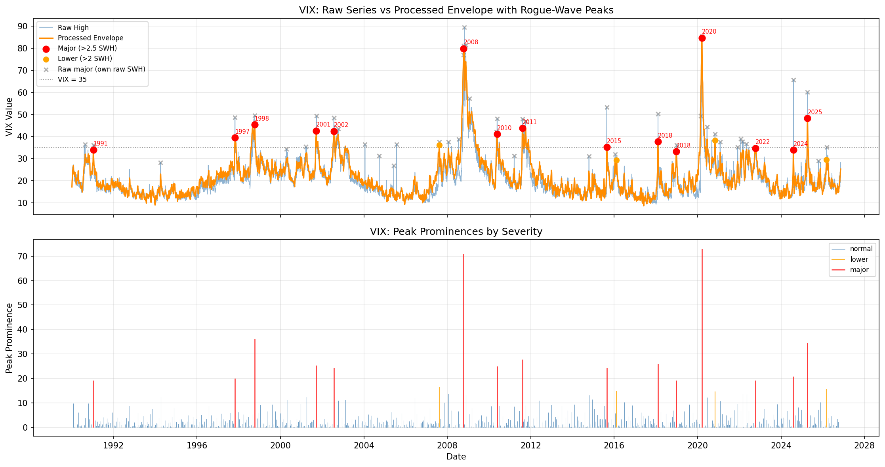

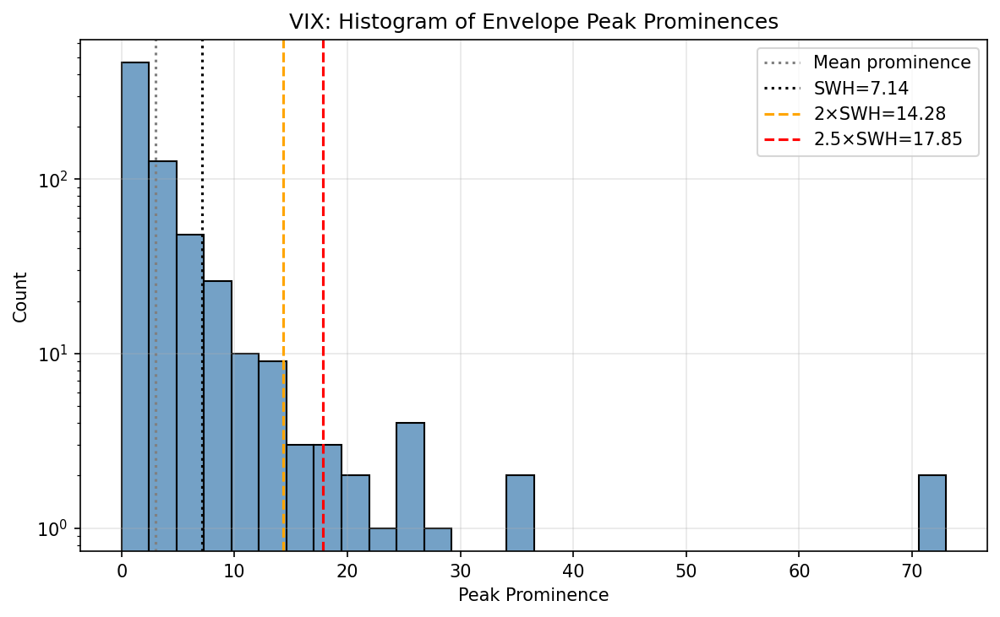

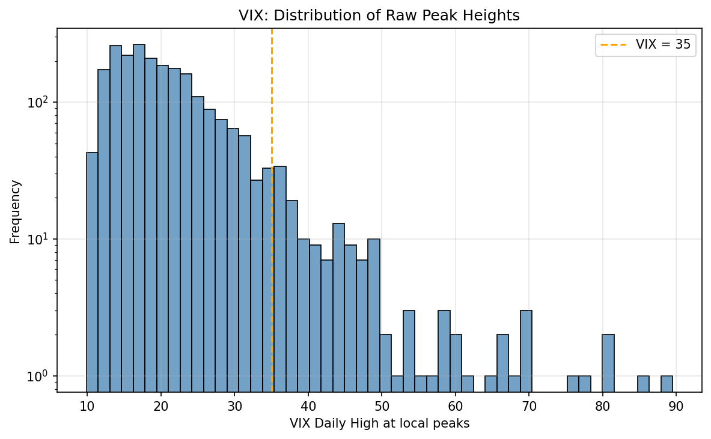

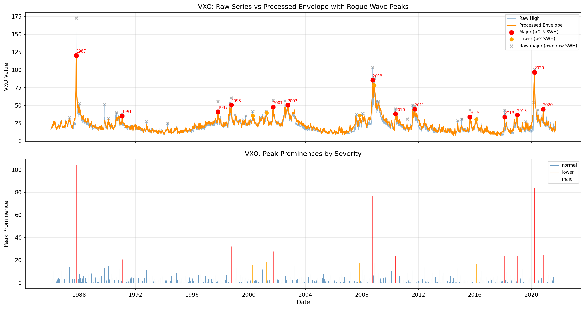

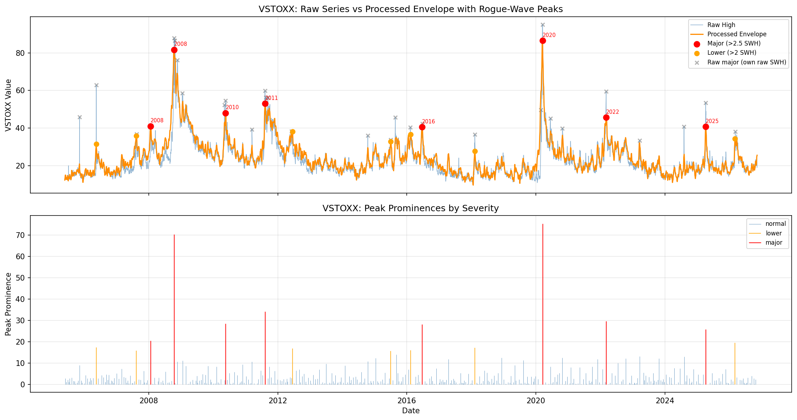

## Experiment 2 | Localization before VIX peaks

In windows ending one to five observations before a retrospective major peak, the eigenvector was narrower on average and its maximum was closer to the latest observation. The same ordering appears across the three group means. Assigning a window to a group requires knowing the subsequent peak. Peak dates and windows after the last known peak are excluded from these groups (426 unassigned windows).

| Observations to the next peak | Windows | Mean width | Mean distance to window end | Potential skewness | Excess kurtosis |
|---|---:|---:|---:|---:|---:|
| 1–5 | 75 | 0.0163 | 10.12 | −1.657 | 4.408 |
| 6–30 | 375 | 0.0805 | 26.91 | −0.780 | 0.381 |
| More than 30 | 8,358 | 0.1525 | 42.92 | −0.561 | −0.056 |

Width and distance use the implementation’s observation grid with step 1. The distributions overlap. This reproduces the qualitative direction of localization in the reviewed VIX experiment. The authors’ display normalization is unknown.

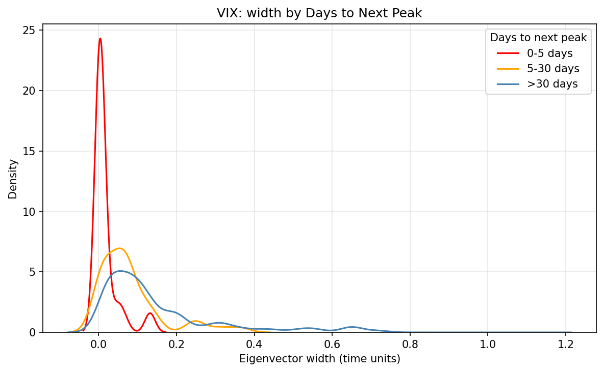

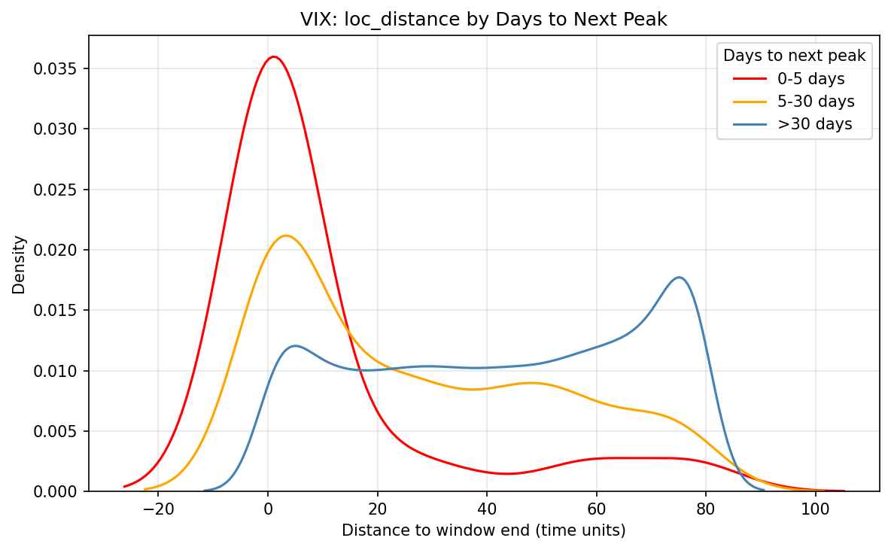

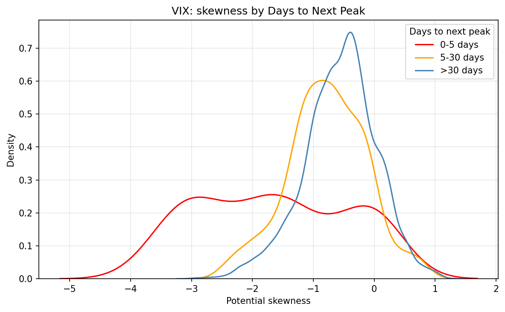

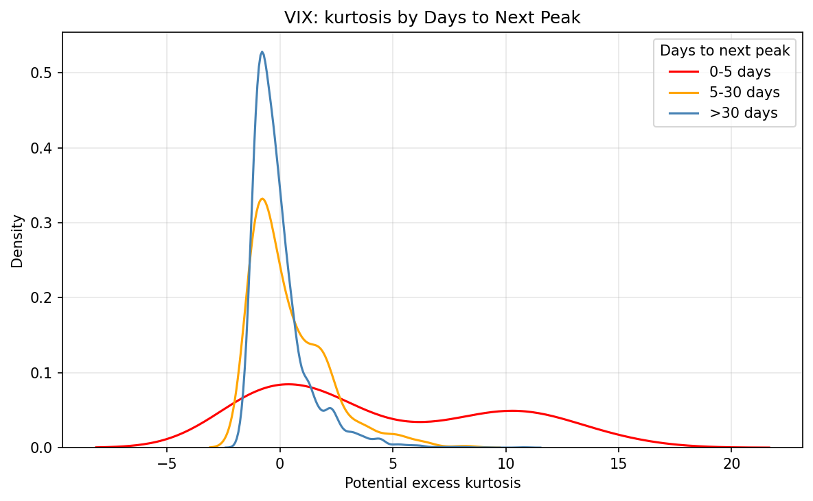

## Experiment 3 | Eigenvalue gradients

On the updated VIX sample, the maximum **signed** gradient of the eigenvalue magnitude was 493.42. It exceeded 74 in 118 of 9,234 windows and exceeded 100 in 83. The scatter plot uses observations to the next known major peak. The four comparison panels put the eigenvalue, potential and squared-envelope gradients on their stated scales. Selecting a trading threshold would require a separate prospective test.

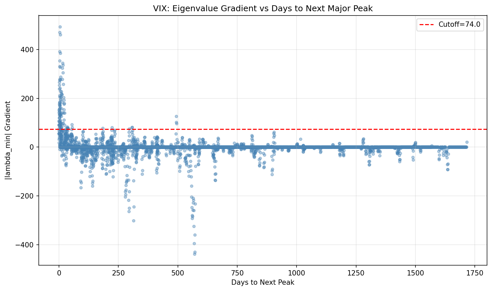

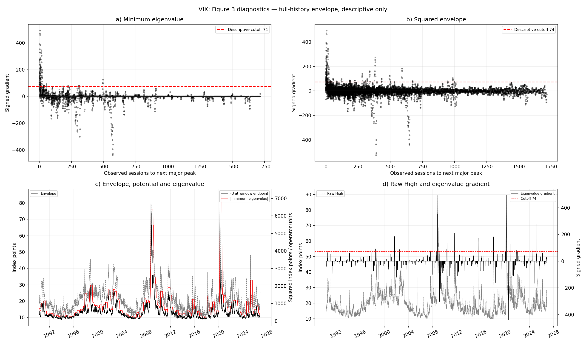

## Experiment 4 | VIX warnings

The frozen `all_bins` run missed exactly the paper’s three major events on **28 October 1997, 2 September 1998 and 6 February 2018**. Of 20 episodes, 16 were useful major detections, three were late and one was associated with a lower event. This gives 80% precision and 0% in the specific false-signal category. In the alternative `spectral_peaks` run only 2/12 events were detected (2/5 useful episodes). Both modes keep the published thresholds.

| VIX, frozen comparison | Distinct events detected | Useful episodes / all | False-signal rate | Precision | Precision excluding late |
|---|---:|---:|---:|---:|---:|
| Paper, major | 9/12 | 16/19 | 0% | 84.2% | 94.1% |
| QCA, major | 9/12 | 16/20 | 0% | 80.0% | 94.1% |
| Paper, lower threshold | 9/15 | 16/19 | 0% | 84.2% | 100% |
| QCA, lower threshold | 9/15 | 16/20 | 0% | 80.0% | 100% |

The figure extends the daily warnings to 10 November 2026 and marks events from the fixed paper catalog. In both FFT modes, all 9,003 common VIX warning rows through December 2025 retained the same decisions and M/C/W within numerical tolerance.

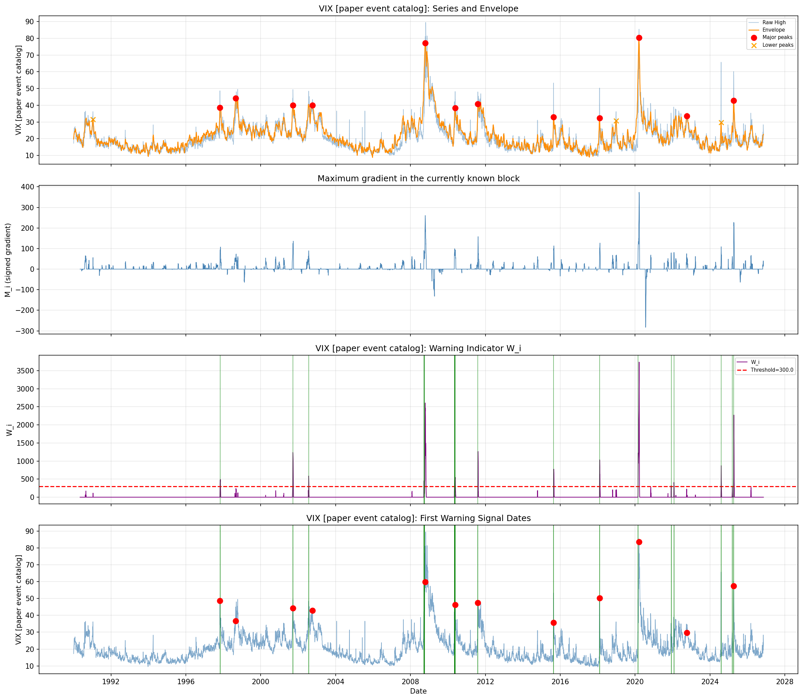

**April 2025 and November 2026.** The paper lists 8 April 2025 as a VIX envelope peak. The `all_bins` warnings of 12 March and 7 April preceded it by 19 and one observed sessions. The authors list 11 March and 7 April. The 7 April warning arrived after the S&P 500 declines of 3–4 April. The first `spectral_peaks` warning arrived on 10 April. April belongs to the paper’s development/evaluation history. For the retrospectively selected November selloff, both modes gave W = 0 on each observed date from 2 through 10 November. With only three subsequent sessions after 5 November, the retrospective event label remains provisional. [Event study and original checks](../EVENT_STUDY.md)

## Experiment 5 | VXO warnings

For the frozen 1986–2020 comparison, `all_bins` missed the same single major event as the authors, **24 May 2010**. Of 16 warning episodes, 11 were useful, three were false and two were associated with lower events. The lower-threshold catalog shows an additional discrepancy in event detection. The `spectral_peaks` run detected 4/8 major events (4/5 useful episodes).

| VXO, frozen comparison | Distinct events detected | Useful episodes / all | False-signal rate | Precision | Precision excluding late |
|---|---:|---:|---:|---:|---:|
| Paper, major | 7/8 | 12/19 | 15.8% | 63.2% | 66.7% |
| QCA, major | 7/8 | 11/16 | 18.75% | 68.75% | 68.75% |
| Paper, lower threshold | 10/13 | 14/19 | 15.8% | 73.7% | 82.4% |
| QCA, lower threshold | 9/13 | 12/16 | 18.75% | 75.0% | 80.0% |

On the **2005–2020 holdout** designated in the paper, `all_bins` detected 3/4 major events with 4/7 useful episodes (57.1%). The updated chart includes the remaining life of VXO in 2021. The frozen score above retains its December 2020 cutoff.

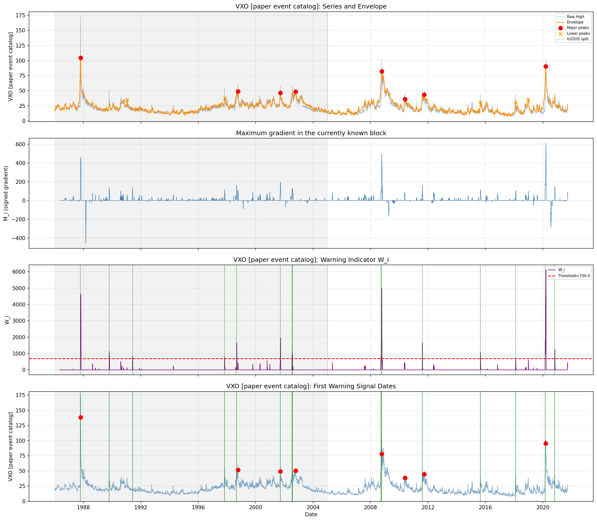

## Experiment 6 | VSTOXX warnings

The paper reports **7/8** major events and **70.6%** precision. The judge’s v2 assessment verified two long partial histories. The new comdirect series covers two additional paper events relative to DAG and includes all six paper major dates from October 2008 through March 2022. The 2001 and 2002 events predate this input.

| Evidence and source | Filter | Detected / covered paper major events | Useful episodes / all | Precision |
|---|---|---:|---:|---:|
| Paper, full sample | Author implementation | 7/8 | 12/17 | 70.6% |
| Judge v2, DAG 2010–2024 | all_bins | 3/4 | 3/5 | 60.0% |
| Judge v2, DAG 2010–2024 | spectral_peaks | 3/4 | 4/4 | 100% |
| Judge v2, Investing 2012–Mar 2025 | all_bins | 3/3 | 3/6 | 50.0% |
| Judge v2, Investing 2012–Mar 2025 | spectral_peaks | 2/3 | 3/5 | 60.0% |
| **11 Nov refresh, comdirect 2005–2026** | **all_bins** | **6/6** | **10/15** | **66.7%** |
| **11 Nov refresh, comdirect 2005–2026** | **spectral_peaks** | **5/6** | **7/8** | **87.5%** |

Among those same six dates, the authors marked five detected and missed 21 June 2016. On comdirect, `spectral_peaks` reproduces that subset exactly. `all_bins` also detects the 2016 event. One qualifying episode began on 27 August 2015, 207 observations early, and a second began on 20 June 2016, one observation early. At a horizon of 20 observations, overall detection on comdirect drops to 5/6. On Investing, the only qualifying episode for the 2016 event began 208 observations early, so its 3/3 drops to 2/3 at all three shorter horizons (20/60/120).

The table uses full-sample precision against the fixed paper catalog. Excluding one unresolved comdirect `all_bins` episode gives 10/14 (71.4%). On Investing the corresponding result is 3/5 (60%). Subsequent dates extend the warning series beyond the authors’ catalog, so these percentages depend on both the scoring endpoint and the available reference events.

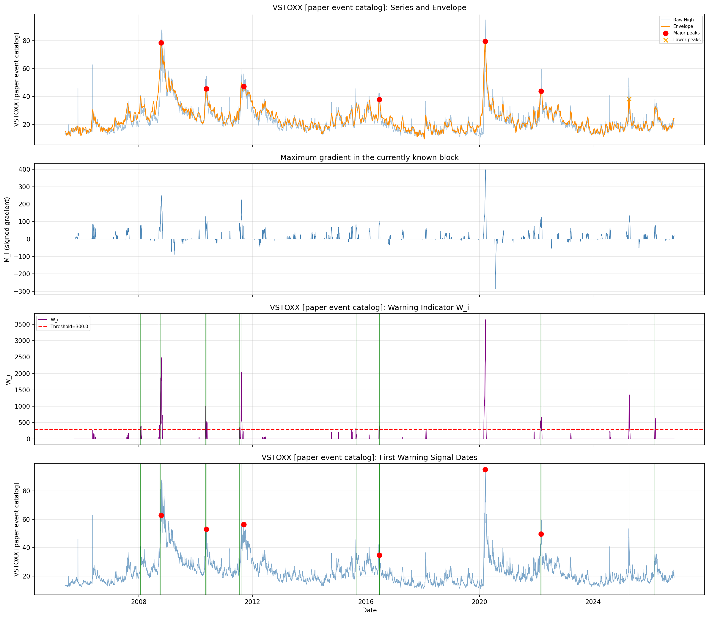

## Independent checks and remaining discrepancies

| Check | Result and scope |
|---|---|
| Added value of the eigenvalue step | The judge found **0 binary differences in 99,971 paired rows** across the 21 historical scenarios against the rolling maximum of the same squared causal envelope. We recounted the saved warning files and obtained the same total. The six refresh runs also agree on all 46,978 paired rows. Dates recur across configurations. Continuous M and W differ. |
| FFT and operator boundaries | Switching the FFT population changed 67 VIX and 63 VXO historical daily decisions. Switching from fixed observed endpoints to ghost Dirichlet boundaries under `all_bins` changed 14 and 13. The paper leaves amplitude normalization unspecified. |
| Causal warnings and retrospective labels | In the judge’s 2024-to-2025 VIX extension, all 8,745 shared W values agreed. A computed historical peak shifted from 4 to 8 September 1998. The reference envelope uses the entire selected sample. |
| Figure 5 and supplements | With positive lag defined as future High, the maximum correlation occurs at −1 or −2 in twelve long VSTOXX scenarios, and at −4 for VXO `spectral_peaks`. For VIX S1b, `spectral_peaks` gives slope −18.217, intercept 158.386 and R² 0.9298, close to −18.2, 158.4 and 0.93 in the paper. S1d gives R² 0.9341 versus 0.895, with p at its upper bound of 3. S1 fitting choices and the calendar-year windows used for S3 limit exact agreement. |
| Inactive plateau and replay checker | The judge’s supplied-bundle `compare_replay.py` run stopped on DAG, 21 Dec 2011. A tied inactive maximum changed offset 2 → 3 and explanatory date 12 → 13 Dec while C = W = 0. The comparator required a new offset of zero. The flat-block rule handles a flat *whole block* and leaves this descending-then-flat case open. Active warnings and historical scores reproduced. |
| CSV precision and data quality | The judge found one-ULP parser differences on four VIX and 28 VXO observations across environments. Binary input fingerprints changed while the tested alarms and metrics agreed. A specified parsing mode would support future portable snapshots. The historical raw VIX source also has identical OHLC for all 505 records in 1990–1991 and some High inconsistencies elsewhere. |
| Fresh calculation checks | All 216 repository tests passed. The independent ledger checker passed on each of the six new runs. Additional dense-matrix calculations checked 28 selected prefixes (280 matrices), including active maxima and final observations. C and alarm decisions agreed throughout, and the largest absolute W discrepancy was below 4 × 10⁻¹⁰. [Numerical evidence and figure hashes](evidence.json) |

For the implemented operator with grid spacing 1 and negative minimum eigenvalue, the judge derived 0 ≤ max(envelope²) − |λmin| ≤ 1 on the retained coordinates. This explains why the eigenvalue and rolling maximum can be close in raw index units. Converting them to alarms includes a gradient, a count and a threshold. The observed agreement at that stage is an empirical result for the tested runs.

## What the verdict leaves open

A one-date author reference calculation containing the actual High history, normalized envelope, ten eigenvalues and M/C/W would distinguish several plausible FFT, scale and boundary conventions. Reproducing the event catalog also requires the authors’ input snapshots, event-date and episode rules, and the S1 aftershock count and fitting window. For VSTOXX, the new extract improves coverage but still lacks the early history containing the 2001 and 2002 events.

The reported scores measure retrospective assignment of warning episodes to published peaks within as many as 240 observed sessions. Establishing prospective value would require a prespecified evaluation period and controls. A trading evaluation would additionally need an execution rule after the daily High becomes available, together with costs. Those questions remain outside the **PARTIALLY REPRODUCED / HIGH** assessment. [Supplement protocol](../SUPPLEMENT_PROTOCOL.md) · [Data and figure replay notes](REPLAY.md)
